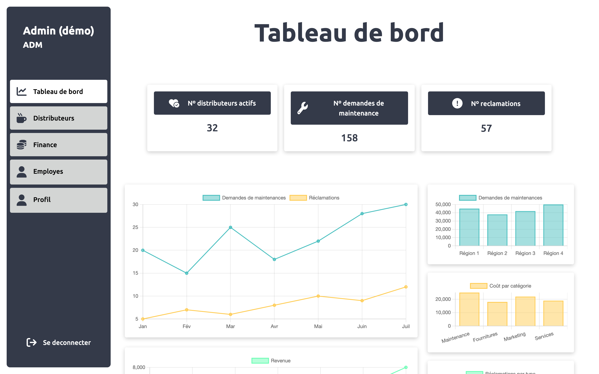
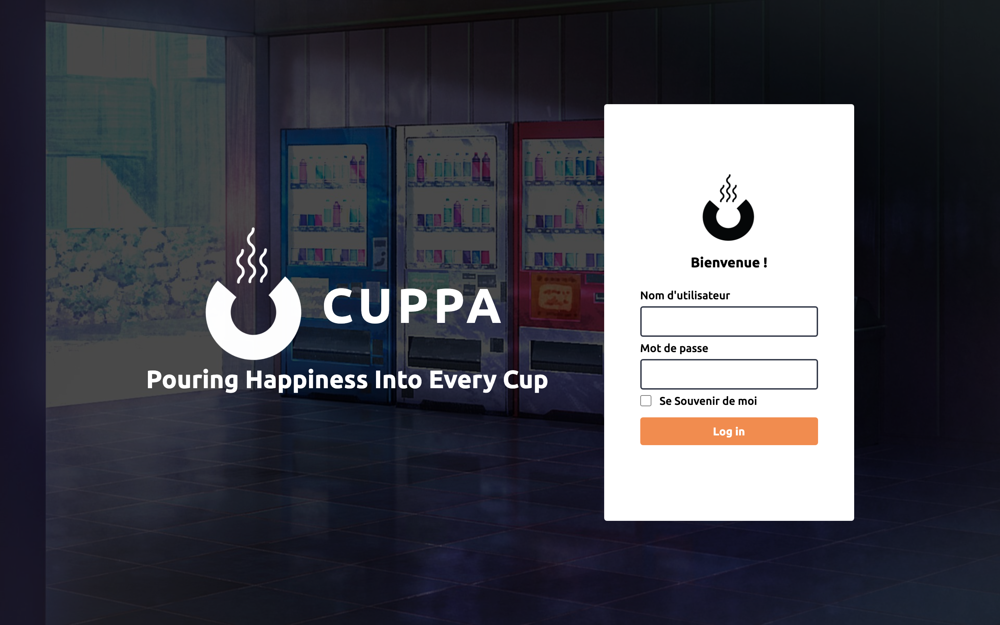
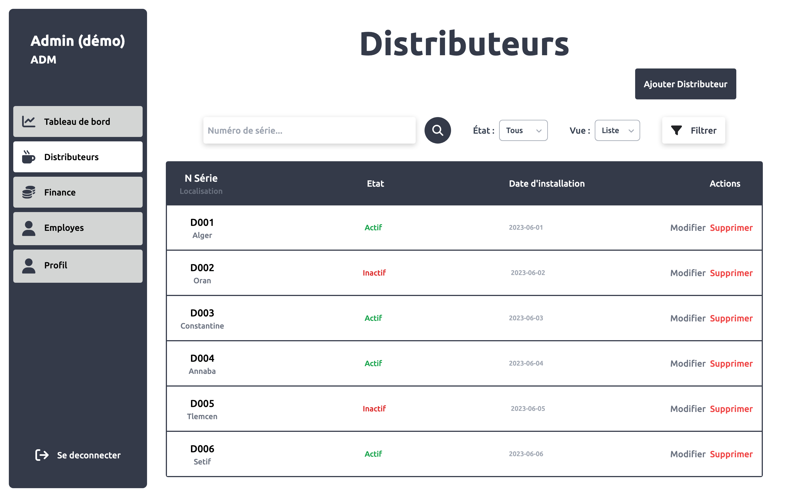
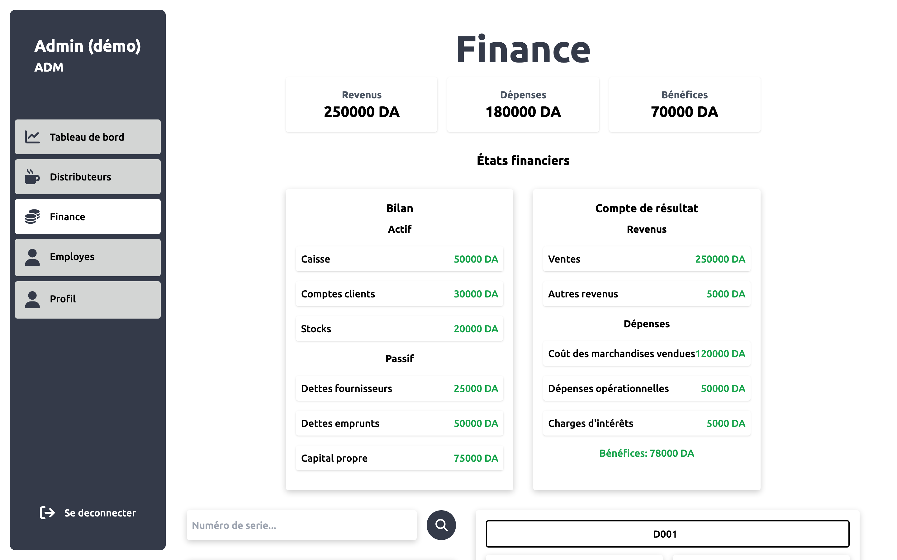
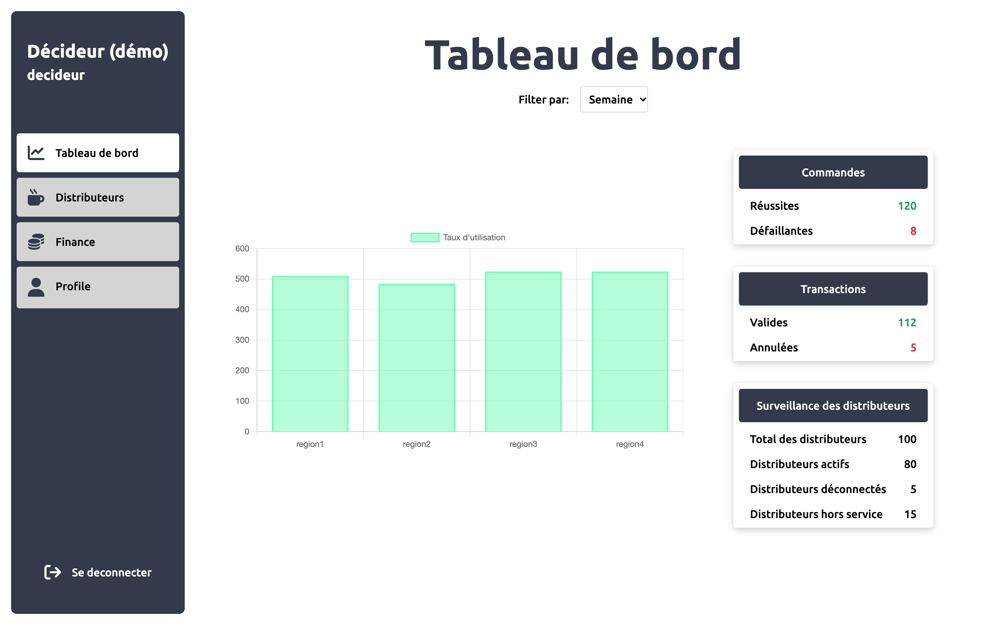

# Cuppa

The web back office for a network of connected drink vending machines, built by a team of four students at ESI Algiers (March to June 2023). Each kind of user gets its own workspace: the platform operator manages client companies and their machines, a client's administrator runs its fleet, staff and finances, commercial agents manage advertising and complaints, and decision-makers follow the figures.



| Login | Fleet of vending machines |
|---|---|
|  |  |

| Finance: balance sheet and income statement | Decision-maker dashboard |
|---|---|
|  |  |

*Captured in November 2026 from the code as committed in June 2023. The project's API is no longer hosted, so these views show the bundled mock data in `helpers/mocks/` with a placeholder session; user names are marked "(démo)".*

## What it covers

- **Four role-based workspaces** chosen at login: platform super-admin (`/sadm`), client administrator (`/adm`), commercial agent (`/ac`) and decision-maker (`/decideur`). A shared layout builds the navigation from the user's role.
- **Fleet management:** list, search and filter machines by serial number and state, add, edit and delete them, assign them to client companies, and place them on a Google Map.
- **Staff management:** add, edit and remove employees through modal forms.
- **Finance:** revenue, costs and profit, with a balance sheet and an income statement per machine.
- **Dashboards** built with Chart.js: maintenance requests and complaints over time, cost by category, usage by region.
- **Commercial agent tools:** advertisers and ad campaigns, the drinks catalogue, and a complaints workflow with a detail page per complaint.

## Stack

Next.js 13 (pages router), React 18, Tailwind CSS with MUI components, Chart.js through react-chartjs-2, Google Maps through @react-google-maps/api, and Axios against the team's REST API.

## Team

Built as a university team project. Commits on this repository: [Nada Hanad](https://github.com/Nada-Hanad) (55), [yassineoo](https://github.com/yassineoo) (28), [Zack-19](https://github.com/Zack-19) (14) and [malak-gouasmia](https://github.com/malak-gouasmia) (1). The team followed a shared [coding charter](docs/CODING_GUIDELINES.md) for naming, comments and commit messages.

## Running it

```bash
npm install
npm run dev        # http://localhost:3000
```

The API URL is set in `config/api.js`. Without a running backend, the login form cannot authenticate; pages that read `helpers/mocks/` still render once a `token` is present in `localStorage`.
